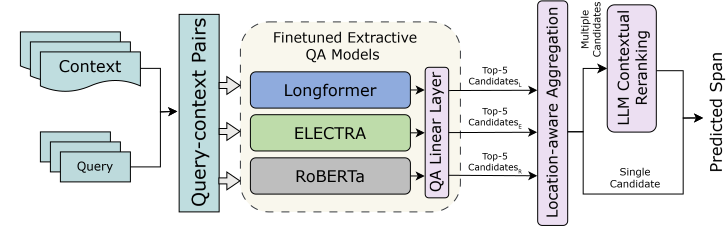

<div id="top"></div>

<!-- PROJECT LOGO -->
<br />

<div align="center">
  <h1 align="center">Context-Aware Phrase Retrieval for Occurrence-Level Disambiguation</h1>
  <p align="center">
    Department of Computer Science and Engineering, East Delta University and University of Chittagong, Bangladesh
  </p>

  [Jannatul Naima](mailto:jannatulnaima.cse.cu@gmail.com), Trina Chakraborty, and Tasmia Nuzhat Nova.
</div>

<!-- TABLE OF CONTENTS -->

<details open>
  <summary>Table of Contents</summary>
  <ol>
    <li>
      <a href="#about-the-project">About The Project</a>
    </li>
    <li>
      <a href="#getting-started">Getting Started</a>
      <ul>
        <li><a href="#prerequisites">Prerequisites</a></li>
        <li><a href="#installation">Installation</a></li>
      </ul>
    </li>
    <li>
      <a href="#reproduce-results-for-benchmark">Reproduce results for benchmark</a>
      <ul>
        <li><a href="#1-pr-phrase-retrieval">PR: Phrase Retrieval</a></li>
        <li><a href="#2-psd-phrase-sense-disambiguation">PSD: Phrase Sense Disambiguation</a></li>
      </ul>
    </li>
    <li><a href="#results-folder">Results folder</a></li>
    <li><a href="#license">License</a></li>
    <li><a href="#contact">Contact</a></li>
    <li><a href="#references">References</a></li>
  </ol>
</details>


<!-- ABOUT THE PROJECT -->

## About The Project

When a phrase appears several times in one document, a retrieval system has to find the right occurrence, not just the phrase. [Phrase-in-Context (PiC)](https://phrase-in-context.github.io/) tests this with its Phrase Retrieval (PR) and Phrase Sense Disambiguation (PSD) tasks. Extractive QA models keep only their single best span, and we found that three different QA models can agree with high confidence on the wrong occurrence.

:star2: Official implementation of our paper *Context-Aware Phrase Retrieval Framework for Occurrence-Level Disambiguation*. Our framework has three stages:
<p align="center">
  
</p>
1. **Candidate generation.** We fine-tune ELECTRA, RoBERTa and Longformer as extractive QA models and keep the top 5 spans of each.
2. **Location-aware candidate aggregation.** We pool the spans of all models, filter them, and merge overlapping spans into one candidate per occurrence.
3. **LLM-based contextual reranking.** If more than one candidate is left, Gemini 3.5 Flash reads the document with each candidate marked as `[LOC-i]` and picks the one that matches the query. Questions with a single candidate never reach the LLM.

We report text-only EM/F1 for both tasks. For PSD we also report a location-aware EM/F1, where a prediction counts only if it is at the gold position.

**If you use our code, please consider citing:**

    @inproceedings{naima2026contextaware,
      title={Context-Aware Phrase Retrieval Framework for Occurrence-Level Disambiguation},
      author={Naima, Jannatul and Chakraborty, Trina and Nova, Tasmia Nuzhat},
      booktitle={Proceedings of the 4th ACM SIGIR Conference on Research and Development in Information Retrieval in the Asia Pacific Region (SIGIR-AP)},
      year={2026}
    }

and the PiC benchmark:

    @article{pham2022PiC,
      title={PiC: A Phrase-in-Context Dataset for Phrase Understanding and Semantic Search},
      author={Pham, Thang M and Yoon, Seunghyun and Bui, Trung and Nguyen, Anh},
      journal={arXiv preprint arXiv:2207.09068},
      year={2022}
    }

<!-- GETTING STARTED -->

## Getting Started

### Prerequisites

* Anaconda 4.10 or higher
* Python 3.9 or higher
* pip version 21 or higher
* A GPU for Step 1 (we used [Lightning AI](https://lightning.ai/)) and access to the Gemini API for Step 3 (we used Vertex AI batch prediction)

### Installation

1. Clone the repo

   ```sh
   git clone https://github.com/jannatulnaima-duck/context-aware-phrase-retrieval.git
   cd context-aware-phrase-retrieval
   ```

2. Create and activate a Conda environment

   ```sh
   conda create -n occ_retrieval python=3.9
   conda activate occ_retrieval
   ```

3. Install required libraries

   ```sh
   pip install -r requirements.txt
   pip install -r retrieval_qa/train/requirements.txt
   ```

* The second file is only needed for Step 1. Steps 2 to 4 need just `datasets` and run on CPU.

<!-- USAGE EXAMPLES -->

## Reproduce results for benchmark

* PR is loaded from `PiC/phrase_retrieval` and PSD from `Deehan1866/phrase_sense_disambiguation`, the copy of PiC-PSD we trained on. Use `--hf_dataset` in the pipeline scripts to load another copy.
* To only check our numbers, skip Steps 1 and 3 and use the files already in `results/` (see [Results folder](#results-folder)).

### 1. PR: Phrase Retrieval

#### Step 1: Candidate generation

Change directory to the `retrieval_qa/train` folder
```
cd retrieval_qa/train/
```

We fine-tune each QA model on PR-pass, then evaluate it and predict on the test set
```
export DATASET="phrase_retrieval"
export DATASET_CONFIG="PR-pass"

bash run_model.sh "${DATASET}" "${DATASET_CONFIG}" Longformer
bash run_model.sh "${DATASET}" "${DATASET_CONFIG}" ELECTRA
bash run_model.sh "${DATASET}" "${DATASET_CONFIG}" ROBERTA
```

* `DATASET_CONFIG` can be exported to the followings: `PR-pass` or `PR-page`
* The model can be `Longformer` (`allenai/longformer-base-4096`), `ELECTRA` (`google/electra-base-discriminator`) or `ROBERTA` (`roberta-base`).
* We train with batch size 2, 8 gradient accumulation steps, fp16, max sequence length 512, doc stride 128 and seed 42.
* The n-best files are stored under the folder `../../results/phrase_retrieval/${DATASET_CONFIG}/qa`. Checkpoints are stored in `qa/runs` and are not committed.

#### Step 2: Aggregate and deduplicate candidates

Change directory to the `pipeline` folder
```
cd ../../pipeline/
```

First, we pool the top 5 spans of the three models. Then, we merge overlapping spans into one candidate per occurrence
```
python 01_aggregate_candidates.py --task pr --config PR-pass
python 02_dedupe_clusters.py --task pr --config PR-pass
```

* The first script drops spans longer than 6 words or spanning a sentence boundary, and removes exact duplicates.
* The second script keeps the most confident span of each cluster and saves `oracle_report.json` (oracle recall and random baseline).
* Note that all pipeline scripts read from and write to `../results` by default, so run them from the `pipeline` folder.

#### Step 3: LLM reranking

We build one request for every question that still has more than one candidate
```
python 03_build_llm_batch.py --task pr --config PR-pass
```

* The script writes `pr_llm_batch.jsonl`. We sent it as a Gemini 3.5 Flash batch job on Vertex AI. The prompt is in `prompts/rerank_prompt.txt`.
* Save the output of the job in the same results folder. The scorer reads every file ending with `_predictions.jsonl`, for example `gemini_predictions.jsonl`.

#### Step 4: Scoring

```
python 04_score_predictions.py --task pr --config PR-pass
```

* Questions with a single candidate are answered with it (`auto`), the others use the letter chosen by Gemini (`llm`).
* If Gemini explains instead of answering with one letter, we take the last candidate letter in its text. If there is none, the question is left unscored.
* The scores and predictions are stored in `final_predictionspr.json`.

Our results on PR-pass (5,000 test questions)

|                | EM        | F1        |
|----------------|-----------|-----------|
| **Text-only**  | **95.62** | **96.86** |

3,840 questions had a single candidate and 1,160 went to Gemini. Two of them (`53-1` and `12661-1`) have no usable answer and are left out of the scores. The oracle recall of the candidate pool is 98.22%.

### 2. PSD: Phrase Sense Disambiguation

Training and running PSD is the same as PR. All we need is to update the dataset and its config as follows and keep the rest unchanged.
```
export DATASET="phrase_sense_disambiguation"
export DATASET_CONFIG=""

# Step 1, inside retrieval_qa/train/
bash run_model.sh "${DATASET}" "${DATASET_CONFIG}" Longformer
bash run_model.sh "${DATASET}" "${DATASET_CONFIG}" ELECTRA
bash run_model.sh "${DATASET}" "${DATASET_CONFIG}" ROBERTA

# Steps 2 to 4, inside pipeline/
python 01_aggregate_candidates.py --task psd
python 02_dedupe_clusters.py --task psd
python 03_build_llm_batch.py --task psd
# send psd_llm_batch.jsonl to Gemini and save the output as gemini_predictions.jsonl
python 04_score_predictions.py --task psd
```

* `DATASET_CONFIG` can only be an empty string `""` since PSD has only one version. The pipeline scripts do not need `--config`.
* The results are stored under the folder `../results/phrase_sense_disambiguation`.

Our results on PSD (3,000 test questions)

|                            | EM        | F1        |
|----------------------------|-----------|-----------|
| Text-only (location-blind) | 95.56     | 96.41     |
| **Location-aware**         | **84.86** | **85.02** |

549 questions had a single candidate and 2,451 went to Gemini. Two of them (`12582-2` and `32-2`) have no usable answer and are left out of the scores. The oracle recall of the candidate pool is 98.63%.

<!-- RESULTS FOLDER -->

## Results folder

```
results/
├── phrase_sense_disambiguation/
│   ├── qa/                          # n-best files from Step 1
│   │   ├── Longformerpredict_nbest_predictions.json
│   │   ├── ELECTRApredict_nbest_predictions.json
│   │   └── ROBERTApredict_nbest_predictions.json
│   ├── gemini_predictions.jsonl     # Gemini answers from Step 3
│   ├── oracle_report.json           # oracle recall and random baseline
│   └── final_predictionspsd.json    # scores and predictions
└── phrase_retrieval/PR-pass/        # same files, with final_predictionspr.json
```

To recompute the scores from these files, without a GPU or a Gemini account
```
cd pipeline/
python 01_aggregate_candidates.py --task psd
python 02_dedupe_clusters.py --task psd
python 04_score_predictions.py --task psd
```

* Use `--task pr --config PR-pass` for PR. Step 2 downloads the test set from Hugging Face to read the gold answers.
* We slimmed the n-best and Gemini files with `pipeline/slim_for_release.py`. The scripts only read the parts we kept, so the scores do not change.
* The files that Steps 2 and 3 generate (`aggregated_candidates*.json`, `*_llm_batch.jsonl`) are not committed. The scripts rebuild them in seconds.

<!-- LICENSE -->

## License

Distributed under the MIT License. The PiC dataset is distributed under [CC-BY-NC 4.0](https://creativecommons.org/licenses/by-nc/4.0/).


<!-- CONTACT -->

## Contact

Contact Jannatul Naima via email at [jannatulnaima.cse.cu@gmail.com](mailto:jannatulnaima.cse.cu@gmail.com) or create github issues if you have any questions/requests. Thanks!


<!-- ACKNOWLEDGMENTS -->

## References

* Thang M. Pham, Seunghyun Yoon, Trung Bui, and Anh Nguyen. 2022. [PiC](https://arxiv.org/abs/2207.09068): A Phrase-in-Context Dataset for Phrase Understanding and Semantic Search. arXiv preprint arXiv:2207.09068.
* Huggingface. 2022. transformers/examples/pytorch/question-answering at main. [https://github.com/huggingface/transformers/tree/main/](https://github.com/huggingface/transformers/tree/main/) examples/pytorch/question-answering. Our `retrieval_qa/train` is adapted from it and from the PiC authors' code.
* Iz Beltagy, Matthew E Peters, and Arman Cohan. 2020. [Longformer](https://arxiv.org/abs/2004.05150): The long-document transformer.
* Kevin Clark, Minh-Thang Luong, Quoc V. Le, and Christopher D. Manning. 2020. [ELECTRA](https://arxiv.org/abs/2003.10555): Pre-training text encoders as discriminators rather than generators. In ICLR.
* Yinhan Liu, Myle Ott, Naman Goyal, et al. 2019. [RoBERTa](https://arxiv.org/abs/1907.11692): A robustly optimized BERT pretraining approach.

<p align="right">&#40;<a href="#top">back to top</a>&#41;</p>
